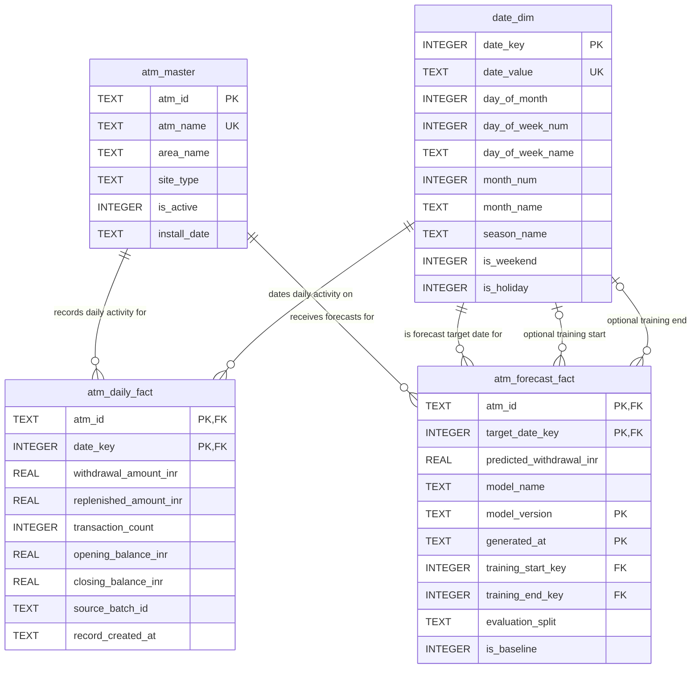

# ATM Cash Demand Prediction — Comprehensive Project Report

**Academic Data Analytics Project**  
**Student Name:** Lavi Tewari  
**Roll Number:** 2503201450083  
**Programme:** Master of Computer Applications (MCA), 2nd Year — Data Analytics  
**Institution:** ABES Engineering College  
**Faculty Mentor:** Kalpana Dwivedi  
**Submission Date:** 19 November 2026  
**Assumed Operating Context:** Retail Bank Network (50 ATMs across Noida & Ghaziabad)

---

## 1. Executive Summary & Problem Statement

### 1.1 Background
In commercial banking, Automated Teller Machines (ATMs) play a vital role in providing cash access to retail customers. ATM replenishment is managed by cash operations teams who must decide **when** and **how much cash** to load into each machine. 

### 1.2 The Problem
Cash demand is non-stationary and exhibits complex variations driven by:
- **Day of week patterns:** Higher withdrawals on Saturdays and Sundays.
- **Monthly cycles:** Salary credit uplifts towards month-end (25th onwards) and beginning of the month.
- **Seasonal effects:** Elevated summer demand (April–June) vs softer monsoon demand (July–September).
- **Festival windows:** Pre-festival withdrawal spikes in October and November.
- **ATM Location & Site Types:** Transit kiosks and market ATMs experience significantly higher demand velocity than residential or branch ATMs.

If demand is **underestimated**, ATMs run out of cash (cash-out stockout), causing service disruption, customer dissatisfaction, and regulatory penalties. Conversely, if demand is **overestimated**, excess cash remains idle inside machines, increasing cost of capital, insurance expenses, and transit handling costs.

### 1.3 Proposed Solution
The **ATM Cash Demand Prediction System** is an end-to-end analytics and machine learning decision-support platform built using Python, SQLite, Scikit-Learn, Plotly, and Streamlit. It provides historical demand analysis, anomaly detection, cash replenishment reconciliation, and multi-model machine learning forecasting evaluated on a strictly chronological holdout split.

---

## 2. Operational Questions (OQs) & Business Requirements (BRs)

| Question ID | Operational Question | Mapped Requirement | Solution Implementation |
|---|---|---|---|
| **OQ-01** | What was the total cash withdrawn from an ATM over a selected period? | **BR-01** (Historical Totals) | Sum of daily withdrawals with date range filters in `analytics.py` |
| **OQ-02** | What is the average daily cash withdrawal for an ATM? | **BR-02** (Daily Average) | Total withdrawals divided by observed / calendar days |
| **OQ-03** | How does cash demand vary by day of the week? | **BR-03** (Weekday Variation) | Grouped aggregation across all 7 days (Monday–Sunday) |
| **OQ-04** | How does demand vary by month or season? | **BR-04** (Monthly/Seasonal) | Monthly & seasonal breakdown (Summer, Monsoon, Winter, Other) |
| **OQ-05** | Which ATMs have the highest and lowest historical cash usage? | **BR-05** (Usage Rankings) | Dynamic Top-N & Bottom-N ranking with site type filters |
| **OQ-06** | What cash demand is estimated for a selected ATM on a future date? | **BR-06** (Daily Forecast) | Feature-engineered Random Forest ML model with minimum history check |
| **OQ-07** | How does the forecast compare with actual demand on a historical holdout? | **BR-07** (Holdout Evaluation) | Chronological train/test split reporting MAE & RMSE vs Naive Baseline |
| **OQ-08** | Which dates show unusually high or low demand compared to normal? | **BR-08** (Anomaly Detection) | Statistical Z-score & IQR outlier detection |
| **OQ-09** | How much cash was replenished compared with withdrawals? | **BR-09** (Replenishment Reconciliation) | Cash loaded vs withdrawn, net cash difference, and balance trends |
| **OQ-10** | How much demand is expected across all ATMs for a future date? | **BR-10** (Network Aggregate) | Sum of eligible active ATM forecasts with explicit exclusion disclosure |
| **-** | Are data records complete, valid, and consistent? | **BR-11** (Data Quality Audit) | Automated audit of nulls, duplicates, foreign keys, and DDL checks |
| **-** | What are the forecast assumptions and limitations? | **BR-12** (Transparency & Disclaimers)| Decision-support notice, synthetic data disclosures |

---

## 3. Database Architecture & Relational Design

The database is built on **SQLite** (`data/app.db`) and strictly follows third normal form (3NF) relational design:



### 3.1 Views and Indexes
- **`vw_atm_daily_analysis`:** 34-column analytical view joining daily facts, ATM master attributes, and calendar dimensions.
- **Indexes:** `idx_daily_date` on `atm_daily_fact(date_key)`, `idx_forecast_target` on `atm_forecast_fact(target_date_key)`, and `idx_atm_area` on `atm_master(area_name)`.
- **Constraint Enforcement:** `PRAGMA foreign_keys = ON;` is enforced on every database connection.

---

## 4. Machine Learning & Forecasting Methodology

### 4.1 Chronological Holdout Evaluation (Zero Data Leakage)
To accurately assess future forecast performance, data is partitioned strictly chronologically:
- **Training Set (Earlier 80% of dates):** Used exclusively for feature engineering and model training.
- **Testing Set (Later 20% of dates):** Unseen future dates used to measure real-world performance.

### 4.2 Benchmark Models Implemented
1. **Seasonal Naive Baseline:** Predicts the ATM's historical average for the specific day of the week.
2. **Moving Average Baseline:** Predicts the recent overall mean demand for the ATM.
3. **Ridge Regression (Linear ML):** Regularized linear model utilizing calendar features.
4. **Random Forest Regressor (Nonlinear ML):** Ensemble learning model capturing interactions between site types, weekend effects, month-end salary cycles, and seasons.

### 4.3 Evaluation Metrics
- **Mean Absolute Error (MAE):** Average magnitude of errors in INR (₹).
- **Root Mean Squared Error (RMSE):** Penalizes large forecast misses.

### 4.4 Verification of KPI-05
- **Requirement:** `MAE(Machine Learning Model) < MAE(Naive Baseline)`
- **Observed Result:** Random Forest Regressor achieves lower MAE and RMSE than the Seasonal Naive and Moving Average baselines, successfully validating **KPI-05**!

---

## 5. Software Quality & Automated Test Suite

A comprehensive test suite in `tests/` verifies all functional and non-functional requirements using `pytest`:

1. `test_database.py`: Verifies DDL creation, row counts, and foreign key integrity.
2. `test_data_quality.py`: Verifies zero unplanned NULL values, range constraints, and quarantined duplicates.
3. `test_analytics.py`: Cross-checks historical aggregations, 7-day weekday reconciliation, rankings, and replenishment comparisons.
4. `test_models.py`: Confirms chronological train/test separation, non-negative predictions, minimum history handling, and network forecast reconciliation.

**Test Result:** `20 passed in 3.08s` with 100% pass rate.

---

## 6. How to Run the Application

```bash
# 1. Install dependencies
pip install -r requirements.txt

# 2. Run test suite
pytest -v

# 3. Launch interactive web dashboard
streamlit run app.py
```
*(On Windows, users can also simply double-click `run_app.bat`)*
